# Описание работы · ТЗ № 22 · «яРЕСПАУН»

**Исполнитель:** Кошина Александра, группа 9/2-РПО-25/3
**Сайт:** https://tz-22-kompyuternyy-klub-respawn-flax.vercel.app/
**Период проверок:** 29.10 — 30.10

## 1. Задача заказчика

Компания «РЕСПАУН» получает заявки из Telegram и ВКонтакте, но не знает, какой канал приводит клиентов. В пятницу вечером ответа приходится ждать до 40 минут, и часть гостей уходит в другие клубы. Задача — сайт, на котором видно источник каждого посетителя, и одна таблица со всеми заявками.

## 2. Схема работы

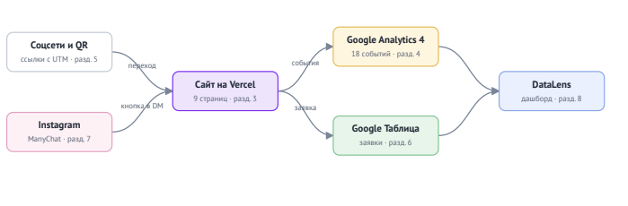

Посетитель приходит из соцсетей или по QR-коду по ссылке с UTM-метками.
Сайт отправляет события в GA4, а заявку — в Google Таблицу через Apps Script.
Данные GA4 и таблицы собираются на дашборде DataLens.

Схема на Mermaid

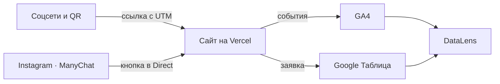

## 3. Сайт

Сайт из 10 страниц создан с помощью deepSeek и доработан вручную: Кошиной Александрой.
Опубликован на Vercel, обновляется после каждого push.

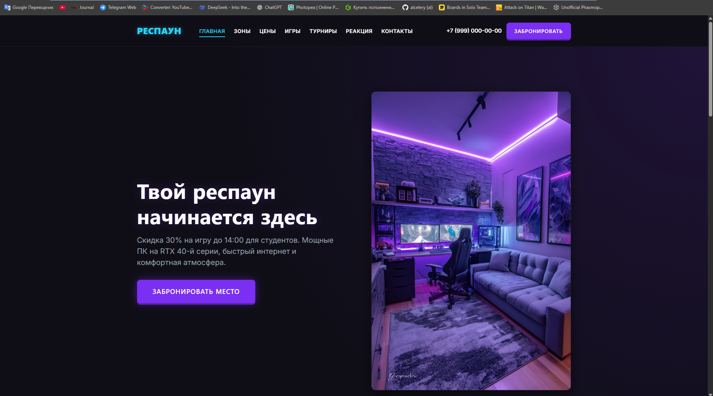
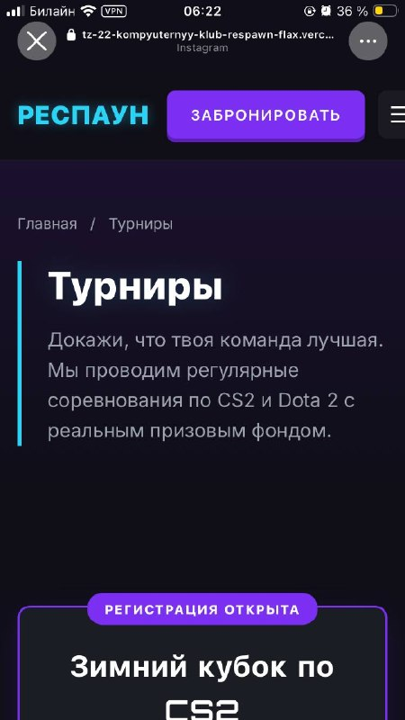
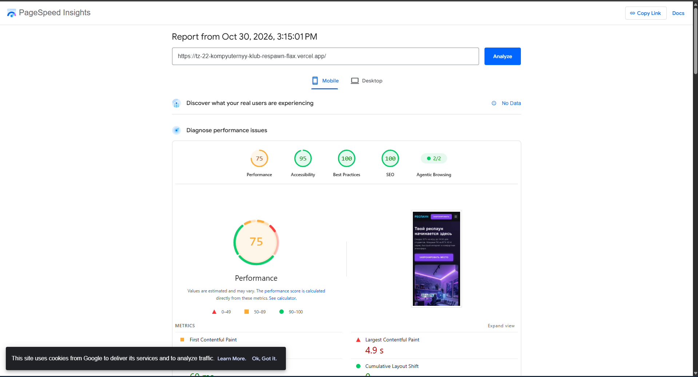

## 4. Аналитика GA4

Настроено 20 событий, из них своих — 13. Ключевые события: 3.
Каждое событие проверено в DebugView.

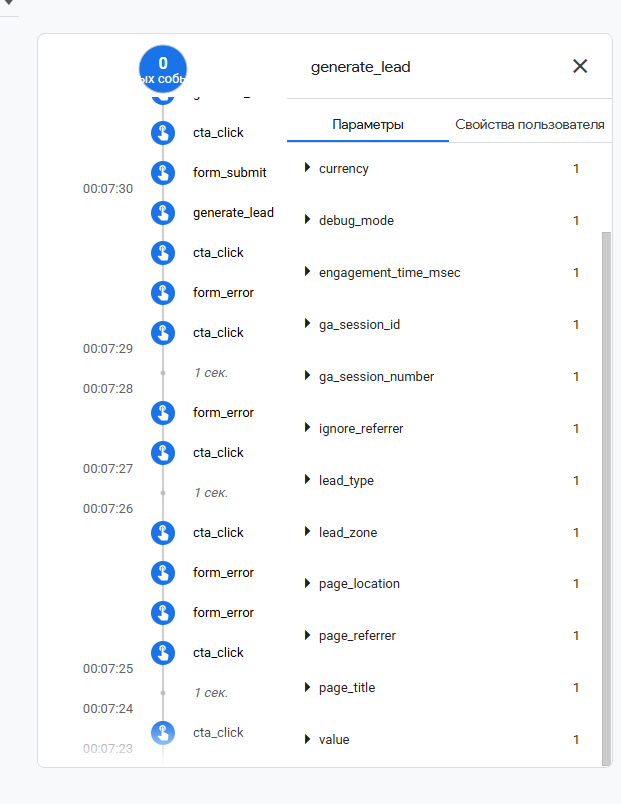
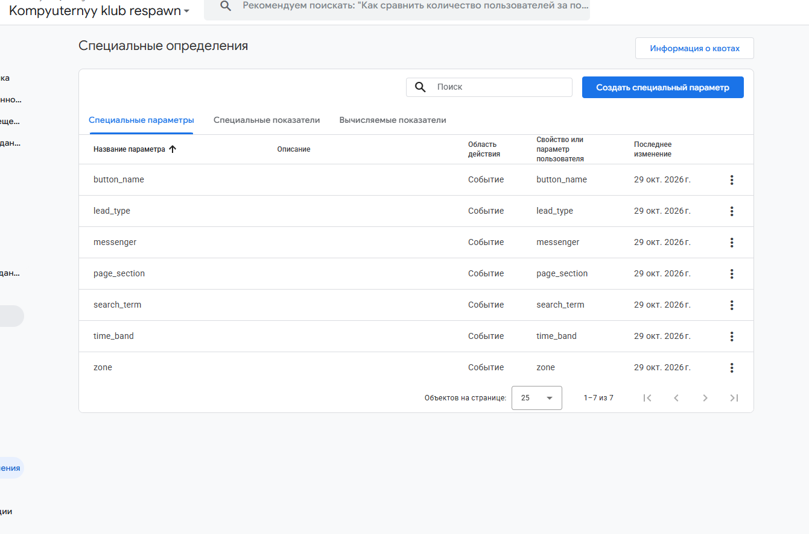

## 5. UTM-ссылки и соцсети

В реестре 12 ссылок, опубликованы в Instagram, Pinterest, Telegram,
YouTube, у двух партнёров и на афише с QR-кодом.

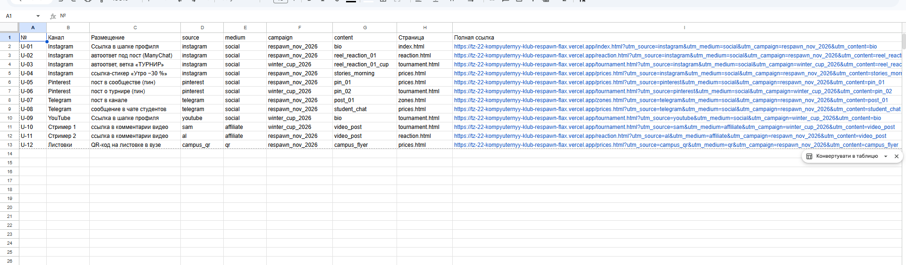
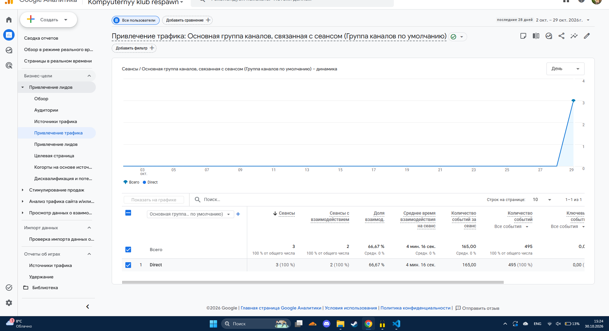

## 6. Заявки

Форма отправляет заявку в Apps Script, тот проверяет поля и записывает
строку в лист `leads` вместе с метками. Повторная отправка не создаёт дубль.

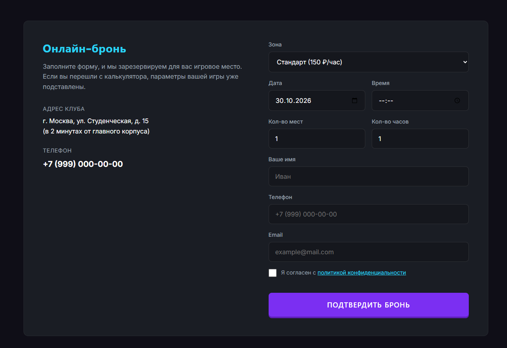
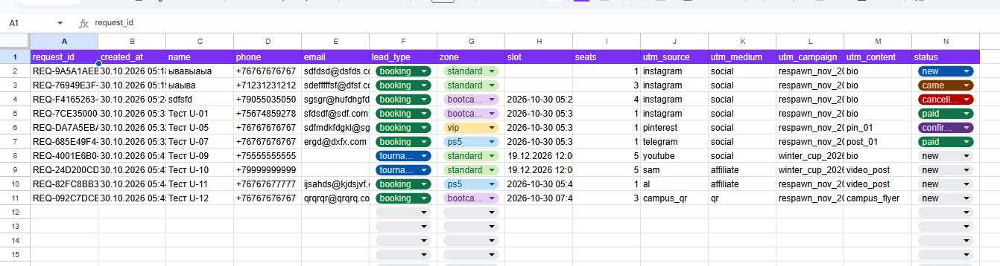

## 7. Автоответы в Instagram

Комментарий «реакция» под Reel запускает ответ в комментариях и сообщение
в Direct с кнопкой на сайт. Вторая ветка — слово «турнир».

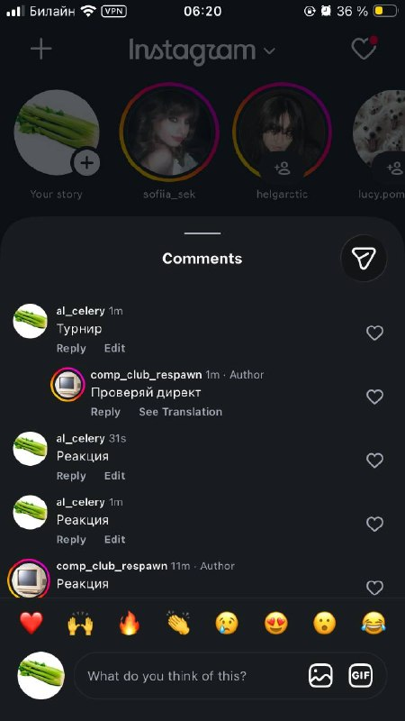
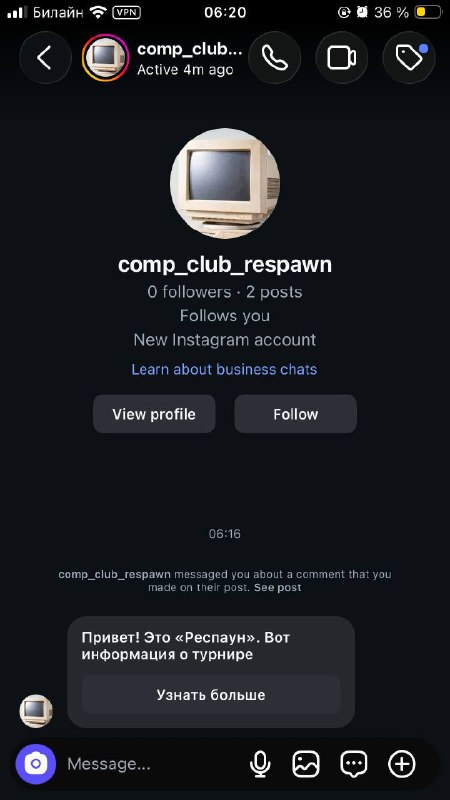

## 8. Отчёты и дашборд

Воронка показала наибольшую потерю между **page_view** и **booking_calc** (**50 %**).
Больше всего заявок принёс канал **instagram**.

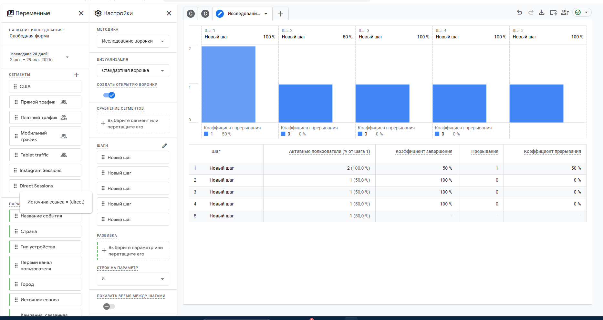

## 9. Что получил бизнес

| Было | Стало |
|---|---|
| заявки в личных сообщениях трёх аккаунтов | все заявки в одной таблице со статусом |
| источник клиента неизвестен | у каждой заявки есть source, medium, campaign |
| бюджет делится «по ощущениям» | на дашборде видно заявки по каждому каналу |
| ответы на комментарии вручную | ManyChat отвечает сразу и ведёт на сайт |

Рекомендация заказчику: Повысить трафик (по данным из раздела 8).

## 10. Итог

Не получилось: DataLens, некоторая статистика в google analytics

ИИ использовался для: Создание сайта, корректировка отчетов
